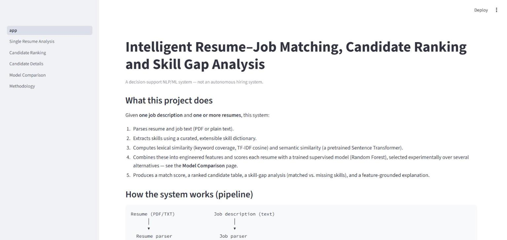
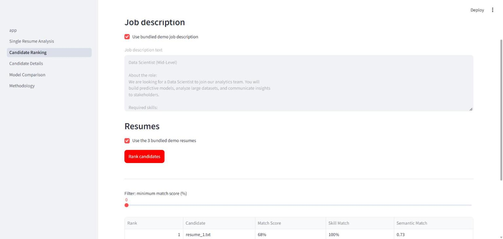
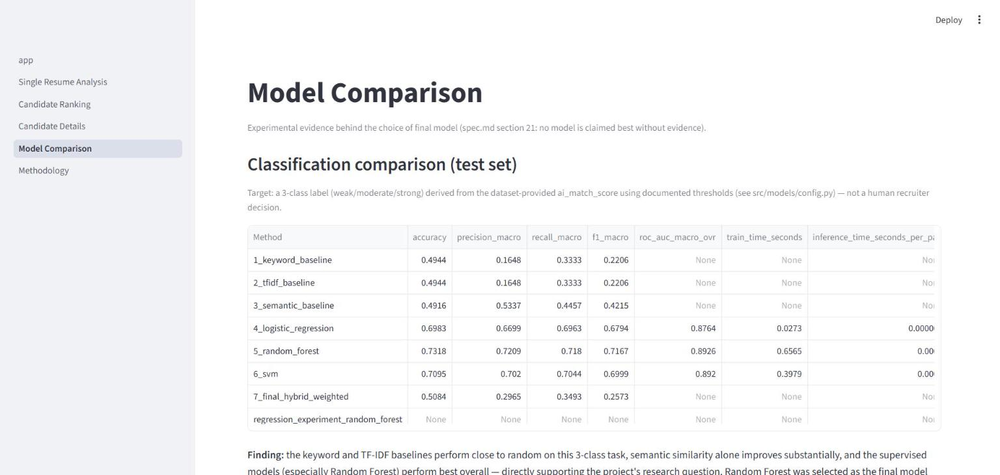

# Intelligent Resume–Job Matching, Candidate Ranking and Skill Gap Analysis using NLP

A decision-support NLP/ML system that scores how well a resume matches a job
description, ranks multiple candidates, identifies matched/missing skills,
and explains the score — built as a solo undergraduate semester project.

**This system does not and must not make autonomous hiring decisions.** It
is a candidate–job relevance and decision-support tool only.

---

## 1. Problem statement

Manually screening resumes against a job description is slow and
inconsistent. Simple keyword matching is fast but brittle — it misses
paraphrased skills ("built ML models" vs. "Machine Learning") and ignores
context. This project investigates whether combining lexical similarity,
semantic similarity, and engineered matching features — scored by a trained
model — produces a meaningfully better candidate ranking than naive keyword
matching, while remaining explainable and free of protected-attribute bias.

## 2. Research question

> Can combining lexical similarity, semantic similarity, skill matching, and
> candidate-specific features improve resume–job matching and candidate
> ranking compared with simple keyword-based matching?

**Answer, with evidence (see §9 Results):** Yes. On the held-out test set,
the keyword and TF-IDF baselines score F1(macro) ≈ 0.22 — barely better than
predicting the majority class. Semantic similarity alone more than doubles
that to F1 ≈ 0.42. A supervised Random Forest trained on the combined
feature set reaches F1 ≈ 0.72 and ROC-AUC ≈ 0.89. The same ordering holds in
ranking quality (MRR, NDCG@5) — see the **Model Comparison** page in the app
or `reports/results/`.

## 3. Objectives

- Parse resumes (PDF/TXT) and job descriptions (raw text) robustly, degrading
  gracefully on malformed input.
- Extract skills deterministically via a curated, extensible dictionary.
- Compare keyword, TF-IDF, and sentence-transformer semantic similarity as
  successive baselines.
- Engineer a leakage-safe feature set and train/compare classical ML models.
- Produce a ranked candidate table, a skill-gap breakdown, and a
  feature-grounded (non-fabricated) explanation for every score.
- Ship all of the above as a working, locally runnable Streamlit app.

---

## 4. Dataset sources

| Dataset | Source | Status |
|---|---|---|
| Kaggle Resume Dataset | https://www.kaggle.com/datasets/snehaanbhawal/resume-dataset | Present (`data/raw/Resume/Resume.csv`, 2,484 resumes, 24 categories) |
| Kaggle LinkedIn Job Postings 2023-2024 | https://www.kaggle.com/datasets/arshkon/linkedin-job-postings-2023-2024 | **Not downloaded.** Job-side analysis currently uses the HF dataset's `job_text` field instead (documented substitution, see `data/README.md`). |
| HF `batuhanmtl/job_resume_fit` | https://huggingface.co/datasets/batuhanmtl/job_resume_fit | Loaded automatically via `datasets.load_dataset` (2,385 paired resume/job rows) |

`ai_match_score`, `skill_string_match_score`, and `fuzzy_match_score` in the
HF dataset are **dataset-provided matching signals, not human recruiter
decisions**. They are treated as such throughout this project.

## 5. Dataset setup

Raw datasets are **not** committed to Git (see `.gitignore`). Full download
and expected-path instructions: [`data/README.md`](data/README.md). A tiny,
synthetic demo set (`data/external/demo/`) is bundled and tracked in Git so
the app and tests run without downloading anything.

---

## 6. Folder structure

```
.
├── spec.md                     Full project specification (authoritative)
├── README.md                   This file
├── requirements.txt
├── .gitignore / .env.example
│
├── data/
│   ├── raw/                    gitignored — place downloaded datasets here
│   ├── processed/               gitignored — pipeline-generated data
│   ├── external/demo/           tracked — tiny bundled sample resumes/JD
│   ├── skills/skill_dictionary.json   tracked — curated skill vocabulary
│   └── README.md                dataset download/setup instructions
│
├── notebooks/                  reproducible EDA scripts (percent-script style)
│   ├── 01_eda_resume_dataset.py
│   └── 02_eda_resume_job_fit_dataset.py
│
├── src/
│   ├── data/                   resume_parser.py, job_parser.py
│   ├── preprocessing/          text_cleaning.py
│   ├── skills/                 skill_extractor.py
│   ├── matching/                keyword_baseline.py, tfidf_similarity.py,
│   │                            semantic_similarity.py, hybrid.py,
│   │                            skill_gap.py, explainability.py
│   ├── features/               feature_engineering.py
│   ├── models/                 config.py, train_supervised.py, inference.py
│   ├── ranking/                rank_candidates.py
│   ├── evaluation/             ranking_metrics.py
│   └── utils/                  paths.py (no hardcoded absolute paths anywhere)
│
├── models/                     trained artifacts (TF-IDF vectorizer, scaler,
│                                LogReg/RF/SVM/regressor, training_config.json)
├── reports/
│   ├── figures/                EDA + evaluation plots, app screenshots
│   └── results/                JSON: EDA summaries, model/ranking comparison
│
├── app/                        Streamlit application (6 pages)
├── tests/                      pytest unit tests (44 tests)
└── conftest.py                 makes `src` importable from tests
```

---

## 7. System architecture

```
Resume (PDF/TXT)              Job description (text)
      │                              │
      ▼                              ▼
  Resume parser                 Job parser
      │                              │
      └─────────────┬────────────────┘
                     ▼
            Skill extraction (curated dictionary)
                     │
                     ▼
     Keyword coverage · TF-IDF similarity · Semantic similarity
                     │
                     ▼
            Feature engineering (no PII, no protected attributes)
                     │
                     ▼
   Trained supervised model (Random Forest) ──or── transparent hybrid score
                     │
                     ▼
        Match score · Ranking · Skill gap · Explanation
```

## 8. Methodology

**Preprocessing** (`src/preprocessing/text_cleaning.py`): Unicode/whitespace
normalization and HTML stripping, deliberately **without** removing
punctuation — `C++`, `C#`, `.NET`, `Node.js` must survive.

**Skill extraction** (`src/skills/skill_extractor.py`): deterministic,
dictionary-based, word-boundary-aware regex matching over
`data/skills/skill_dictionary.json` (canonical names + aliases, e.g.
`ML` → `Machine Learning`). No ML model — fully testable, no negation
handling (documented limitation).

**Matching methods compared:**
1. **Keyword baseline** — skill coverage = matched / total required skills.
2. **TF-IDF + cosine similarity** — vectorizer fit only on the training split.
3. **Sentence-Transformer** (`all-MiniLM-L6-v2`, frozen, never fine-tuned) —
   cosine similarity between embeddings.
4. **Supervised models** — Logistic Regression, Random Forest, SVM trained
   on 9 engineered features (no PII, no protected attributes).
5. **Final hybrid** — a transparent, documented weighted combination
   (`src/matching/hybrid.py`, weights in that file, not hidden).

**Target definition** (`src/models/config.py`): `ai_match_score` (0–100) is
bucketed into `weak` / `moderate` / `strong` at configurable thresholds
(70 / 40). A secondary regression experiment predicts the continuous score
directly (R² ≈ 0.76 on held-out test data).

**Leakage prevention:** exact-duplicate resumes dropped before splitting;
TF-IDF vectorizer and feature scaler fit **only** on the training split;
sentence-transformer embeddings come from a frozen pretrained model (not fit
on this data), so precomputing them for all splits does not leak target
information. Full training pipeline: `src/models/train_supervised.py`.

## 9. Models and evaluation

70/15/15 train/val/test split (stratified), random seed 42. Test set: 358
pairs.

| Method | Accuracy | Precision (macro) | Recall (macro) | F1 (macro) | ROC-AUC (macro, OvR) |
|---|---|---|---|---|---|
| 1. Keyword baseline | 0.494 | 0.165 | 0.333 | 0.221 | — |
| 2. TF-IDF baseline | 0.494 | 0.165 | 0.333 | 0.221 | — |
| 3. Semantic baseline | 0.492 | 0.534 | 0.446 | 0.422 | — |
| 4. Logistic Regression | 0.698 | 0.670 | 0.696 | 0.679 | 0.876 |
| 5. **Random Forest (final)** | **0.732** | **0.721** | **0.718** | **0.717** | **0.893** |
| 6. SVM | 0.710 | 0.702 | 0.704 | 0.700 | 0.892 |
| 7. Final hybrid (manual weights) | 0.508 | 0.297 | 0.349 | 0.257 | — |

Ranking evaluation (synthetic multi-candidate queries, true pair + 9 sampled
distractors per test job, Precision/Recall/NDCG@5, 358 queries):

| Method | Precision@5 | Recall@5 | MRR | NDCG@5 |
|---|---|---|---|---|
| Keyword baseline | 0.007 | 0.034 | 0.060 | 0.018 |
| Semantic baseline | 0.098 | 0.492 | 0.400 | 0.422 |
| Final hybrid (manual weights) | 0.097 | 0.486 | 0.371 | 0.397 |
| **Random Forest (final)** | **0.100** | **0.500** | **0.403** | **0.427** |

**Model selection:** Random Forest was selected as the final model because
it has the best F1/ROC-AUC on held-out data among all supervised models and
the best ranking metrics overall, with acceptable inference latency (~0.1ms
per pair). This was an experimental choice, not an assumption — see
`reports/results/model_comparison.json`.

**Notable finding:** the manually-weighted hybrid baseline performs *worse*
on the fixed-threshold classification task than semantic similarity alone,
even though its *ranking* quality is close to the learned model. This shows
that hand-picked weights don't automatically produce well-calibrated
absolute scores, even when they preserve a reasonable relative ordering —
a genuine, documented argument for preferring the learned model over the
manual hybrid as the final scorer (full discussion in the app's
**Model Comparison** page).

## 10. Results — EDA highlights

- Resume dataset: 2,484 resumes, 24 categories, 2 exact duplicates, mean
  length ≈ 811 words. **37.6% of resumes have zero skills detected** by the
  (currently tech-skewed) skill dictionary — expected, since the dataset
  spans non-technical categories (CHEF, TEACHER, AVIATION, ...) that the
  current dictionary doesn't cover; documented limitation, easy to extend.
- HF fit dataset: 2,385 pairs, 23 categories, `ai_match_score` mean ≈ 44,
  std ≈ 25; correlation between `ai_match_score` and `fuzzy_match_score` ≈
  0.63 (moderate agreement between the dataset's own scoring signals).

Full figures: `reports/figures/`. Full numeric summaries:
`reports/results/resume_eda_summary.json`,
`reports/results/resume_job_fit_eda_summary.json`.

## 11. Screenshots

| Home | Candidate Ranking | Model Comparison |
|---|---|---|
|  |  |  |

Captured from a locally running instance (`streamlit run app/app.py`),
verified end-to-end with the bundled demo data.

---

## 12. Local setup

```bash
python -m venv .venv
.venv\Scripts\activate          # Windows
# source .venv/bin/activate     # macOS/Linux
pip install -r requirements.txt
```

## 13. Running tests

```bash
python -m pytest tests/ -q
```
44 tests covering preprocessing, skill extraction, resume/job parsing
(including malformed-input handling), keyword/TF-IDF/hybrid matching,
skill-gap wording, explainability, ranking, ranking metrics, and model
config thresholds.

## 14. Training the models

Requires the HF dataset (downloaded automatically) and an internet
connection the first time (to fetch `all-MiniLM-L6-v2` and the dataset).

```bash
python notebooks/01_eda_resume_dataset.py
python notebooks/02_eda_resume_job_fit_dataset.py
python -m src.models.train_supervised
```

This regenerates `models/*.joblib`, `models/training_config.json`,
`reports/figures/*.png`, and `reports/results/*.json`.

## 15. Running the Streamlit app

```bash
streamlit run app/app.py
```

Open http://localhost:8501. Use the "bundled demo" checkboxes on the
**Single Resume Analysis** and **Candidate Ranking** pages to try the system
without any dataset downloads. The first semantic-similarity call in a
fresh session takes ~20-30 seconds while the sentence-transformer model
loads into memory; subsequent calls are fast.

---

## 16. Deployment

**Target:** Streamlit Community Cloud via GitHub.

**Status: not deployed from this environment** — deployment requires
connecting a GitHub repository to a Streamlit Cloud account, which needs
interactive browser authentication this environment doesn't have. The
repository is deployment-ready (see verification below); deploying is a
~2-minute manual step for whoever owns the GitHub/Streamlit Cloud account.

**To deploy once the repo is pushed to GitHub:**
1. Go to https://share.streamlit.io and sign in with GitHub.
2. "New app" → select this repository and branch.
3. Main file path: `app/app.py`.
4. Deploy. Streamlit Cloud installs `requirements.txt` automatically and
   downloads `all-MiniLM-L6-v2` on first use (cached afterward).
5. The trained model artifacts under `models/` are committed to the repo, so
   the deployed app loads them directly — **it never retrains**.

**Pre-deployment checklist (verified):**
- [x] `app/app.py` is a valid Streamlit entry point with 5 pages under `app/pages/`.
- [x] `requirements.txt` lists only directly-used, version-pinned packages.
- [x] No hardcoded absolute paths anywhere (`src/utils/paths.py` resolves
      everything relative to the repo root).
- [x] Raw datasets are not required at runtime (app works on demo data).
- [x] Trained artifacts (`models/*.joblib`) are committed, not retrained at
      deploy time.
- [x] `all-MiniLM-L6-v2` is downloaded/cached by `sentence-transformers` at
      runtime, not bundled into Git.
- [x] No secrets committed (`.env.example` documents that none are
      currently required).
- [x] `.gitignore` excludes raw data, caches, and the virtual environment.

## 17. Limitations

- Skill dictionary is tech/data-role-biased (see §10 EDA finding).
- Dictionary-based skill extraction has no negation handling (e.g. "no
  formal machine learning experience" still registers "Machine Learning" —
  observed directly during manual testing; see `app/pages/5_Methodology.py`).
- LinkedIn Job Postings dataset not yet downloaded; job-side analysis
  currently substitutes the HF dataset's `job_text` field.
- `ai_match_score` reflects the HF dataset's own generation pipeline, not
  verified recruiter outcomes — every downstream metric inherits this.
- Ranking evaluation uses synthetically constructed multi-candidate queries
  (true pair + random distractors), not a dataset-native ranking ground
  truth — a documented methodological choice, not a hidden one.
- Resume datasets are not a representative sample of the real labor market;
  results should not be assumed to generalize across industries, regions,
  or demographic groups.

## 18. Ethical considerations

- No protected attribute (name, gender, age, photo, email, phone, address,
  religion, caste, nationality, marital status) is used as a model feature
  — enforced by construction: features are derived only from resume/job
  **text content** (`src/features/feature_engineering.py`).
- "Missing" a skill is always reported as *"Not detected in submitted
  resume"* (`src/matching/skill_gap.py`), never a claim that the candidate
  lacks the skill.
- The app's Home page states explicitly that this is a decision-support
  tool, not an autonomous hiring system, and that dataset matching scores
  are not verified human decisions.

## 19. Future work

- Download and integrate the LinkedIn Job Postings dataset for native
  job-side EDA and a larger, more diverse required-skills vocabulary.
- Expand `skill_dictionary.json` to cover non-technical categories present
  in the Kaggle Resume Dataset (currently ~38% zero-skill coverage there).
- Add negation-aware skill extraction (e.g. a small dependency-parse or
  regex-based negation window around matched skill phrases).
- Hyperparameter tuning (grid/random search) for the supervised models, and
  possibly an XGBoost comparison.
- A calibrated version of the manual hybrid score (e.g. per-feature
  min-max calibration) to close the gap with the learned model.
- Deploy to Streamlit Community Cloud once connected to a GitHub account.

---

## Deliverables checklist (spec.md section 38)

| # | Deliverable | Status |
|---|---|---|
| 1 | `spec.md` | present |
| 2 | source code | `src/`, `app/` |
| 3 | notebooks | `notebooks/` (reproducible EDA scripts) |
| 4 | preprocessing pipeline | `src/preprocessing/`, `src/data/` |
| 5 | trained models | `models/*.joblib` |
| 6 | evaluation results | `reports/results/*.json` |
| 7 | figures | `reports/figures/*.png`, screenshots |
| 8 | Streamlit application | `app/` (verified working end-to-end) |
| 9 | README | this file |
| 10 | requirements.txt | present, pinned |
| 11 | tests | `tests/` (44 passing) |
| 12 | deployment configuration | §16, verified ready |
| 13 | GitHub repository | local repo initialized, clean `.gitignore` |
| 14 | deployed application URL | **not deployed** — requires manual GitHub/Streamlit Cloud auth (§16) |
